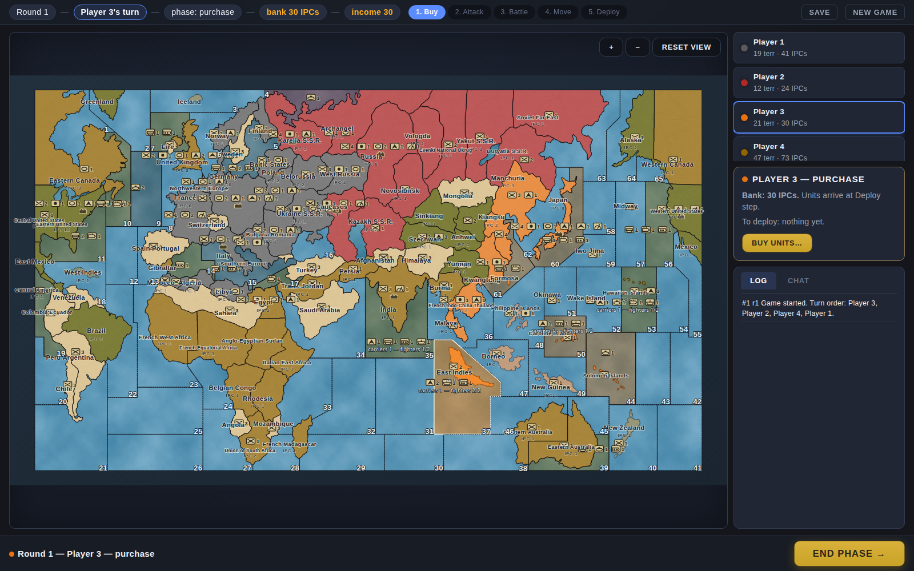
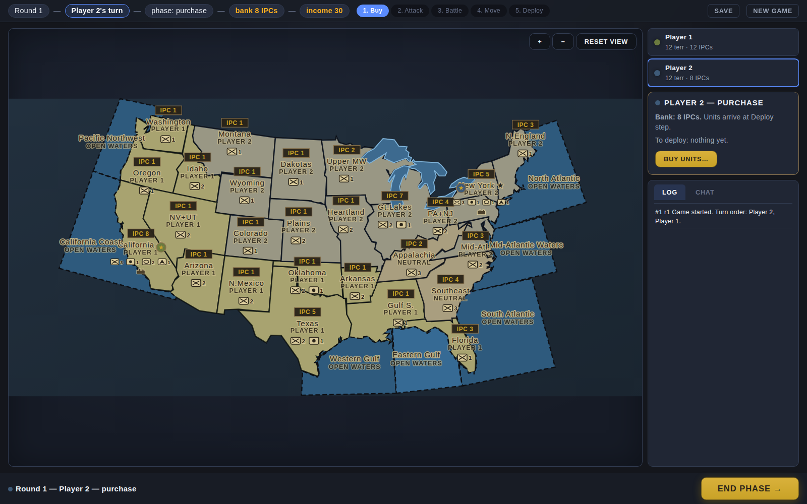
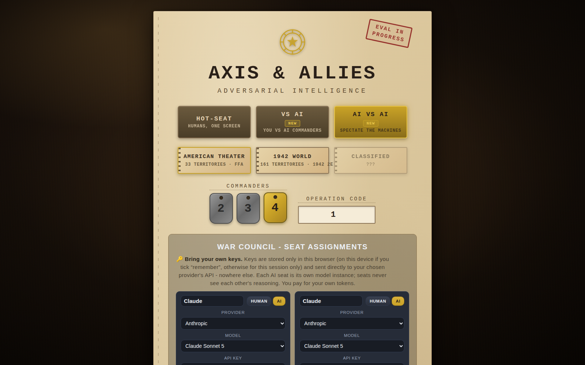

# AI Axis & Allies

[](https://github.com/hayneian000/axis-allies-ai/actions/workflows/ci.yml)

Hot-seat **and** AI-driven Axis & Allies-style strategy, played in the
browser with no backend. Game state lives in the browser, with JSON
export/import. Human players share the keyboard in hot-seat mode, or AI
seats can be filled by LLM agents that play through the same action API,
using your own provider API key (BYOK).

Two maps ship with the game, selectable on the setup screen:

- **America** - a 33-territory map of the continental United States
  (26 land territories + 7 coastal sea zones), 2-4 player free-for-all.
- **1942 World** - the full 1942 world map: 161 territories on the original
  board artwork, with the Axis & Allies 1942 Second Edition setup. Four
  seats (the five powers are merged into four seats: Germany, USSR, Japan,
  and UK + US combined).

> **Unofficial fan project.** This is an unofficial, non-commercial fan
> project. It is not affiliated with or endorsed by Hasbro or Avalon Hill.
> Axis & Allies is a trademark of Hasbro, Inc. The 1942 board data and
> artwork are derived from the TripleA project's `world_war_ii_v5_1942`
> map package - see [`NOTICE`](NOTICE) for attribution and licensing
> details.





## Quickstart

Prerequisites: [Node.js](https://nodejs.org/) 18+ (20 LTS recommended), npm 9+,
a modern browser.

```bash
git clone https://github.com/hayneian000/axis-allies-ai.git
cd axis-allies-ai
npm install
npm run dev      # open the printed URL (usually http://localhost:5173)
```

Production build:

```bash
npm run build     # type-checks (tsc --noEmit), then builds to dist/
npm run preview   # serves dist/ at http://localhost:4173
```

**Hot-seat game:** menu, pick a map, assign seats, play.

**AI game:** menu, pick a game mode with AI seats, set each seat to Human
or AI, pick a provider/model per AI seat and paste its API key. Keys stay
in the browser's local storage - the game calls the provider directly;
there is no server in the middle. See [`SECURITY.md`](SECURITY.md) for the
key-handling model.

## Playing the game

Each turn runs the same six phases - the stepper at the top tracks where you are:

**Buy - Attack - Battle - Move - Deploy - (income)**

1. **Buy** - spend IPCs from your bank on units (they arrive at Deploy).
2. **Attack** - click one of your territories, dial units in the dialog, pick a
   destination. Staged moves preview as arrows (red = attack, green = move).
3. **Battle** - open each battle, roll rounds, assign casualties (or Auto),
   retreat or fight on.
4. **Move** - reposition within your own ground; aircraft must end on ground
   held since turn start or they're lost.
5. **Deploy** - click a factory territory, dial units from your purchase pool,
   stage, then deploy all.
6. **Income** - collect IPCs for territories you hold; capturing a capital
   transfers the victim's bank to you.

**Navy:** the full 1942 naval roster is in play on both maps - transports
(carry 2 ground units), submarines, destroyers, cruisers, carriers, and
battleships - with amphibious assaults, submarine surprise strikes, and
carrier/fighter logistics per the rulebook. On the 1942 board, the Panama
and Suez canals are enforced: a fleet can only use a canal while its side
controls the canal territory (Panama: Central America; Suez: Egypt and
Trans-Jordan).

**Winning:** hold a majority of the capitals simultaneously - 3 of 4 on the
America map, 3 of 5 on the 1942 World map. 20-round cap - then highest
income wins (tie: bank). Lose your capital and you get no purchases and no
income until you take it back. On the 1942 board, the combined UK + US seat
has two capitals (United Kingdom and Eastern United States): it is blocked
only while it holds neither, and capturing either one transfers its bank.

Click any territory to inspect it: owner, IPC value, units, factory status.

## AI players

Each AI seat is an LLM agent that reasons once per phase (batched into two
planning calls per turn) and returns tool calls; the driver validates and
executes them against the engine, exactly like a human's clicks. The
spectator panel shows every seat's rationale, tool calls, and token usage
live - rationale streams in as it generates - with pause/resume/stop and
per-seat error cards (retry, edit key, skip, or pass).

- **Providers (BYOK):** Anthropic, OpenAI, and Meta's Model API (Muse Spark).
- **Diplomacy:** every round opens a negotiation window - freeform chat
  between seats under per-seat token budgets, dumped to JSON at game end.
- **Performance:** turns stream over SSE, agent history is windowed (the
  prompt already carries a full state snapshot), output is token-capped, and
  the static prompt prefix is laid out for provider-side prefix caching.



See [`docs/phase2-agents.md`](docs/phase2-agents.md) for the agent system and
[`docs/m3-diplomacy.md`](docs/m3-diplomacy.md) for the diplomacy design.

## Project structure

| Path        | What it is |
|-------------|------------|
| `engine/`   | Pure headless rules engine - split into focused modules (`units`, `core`, `naval`, `combat`, `actions`, `meta`, plus an `engine.ts` barrel that preserves the public API). No DOM, no I/O. Every state change goes through one validated action function; failures return `{ ok: false, code, error }` and never mutate state. |
| `agents/`   | LLM player system: `agent.ts` (per-seat reasoning + history), `driver.ts` (turn loop), `diplomacy.ts`, `prompts.ts`, `providers/` (Anthropic / OpenAI / Meta adapters), `lobby.ts`, `keys.ts`. |
| `data/`     | All tunable content as JSON: `map.json` + `scenario-2p/3p/4p.json` (America map and setups), `map-1942.json` + `scenario-1942.json` (1942 world map and setup), `units.json` (cost/attack/defense/move), plus the `data.ts` loader and map registry. Balance changes are JSON edits. |
| `ui/`       | Plain DOM + SVG front end (`index.html`, `main.ts`, `style.css`) driving the engine through the action API; `board-1942.jpg` is the 1942 board artwork; `aiGame.ts` runs AI games in the browser. |
| `tests/`    | Engine, rules, agent, and UI tests - see Testing below. |
| `scripts/`  | Dev tooling: `build-map/` (the map pipelines - derives `map.json` from real US boundary data and `map-1942.json` in TripleA board space), `probe-branch.mjs` (`npm run probe`), the screenshot harness. |
| `docs/`     | Guides. Screenshots from UI reviews live in `docs/screenshots/`. |

See [`docs/architecture.md`](docs/architecture.md) for the action API and exactly how an agent drives a turn.

## Documentation

All guides live in [`docs/`](docs/) - see [`docs/README.md`](docs/README.md)
for the index and how to add one.

| Doc | Covers |
|-----|--------|
| [`docs/architecture.md`](docs/architecture.md) | Engine design, game state, the action API (also the agent tool set) |
| [`docs/testing.md`](docs/testing.md) | Test suite guide: per-phase suites, the sim bot, conventions |
| [`docs/browser-testing.md`](docs/browser-testing.md) | Real-browser testing: the `npm run probe` script, the screenshot harness, the deterministic playthrough |
| [`docs/ui-guide.md`](docs/ui-guide.md) | UI conventions: design tokens, DOM contract, theming, review workflow |
| [`docs/style-guide.md`](docs/style-guide.md) | Visual direction: war room, not board-game café |
| [`docs/phase2-agents.md`](docs/phase2-agents.md) | The LLM agent system: providers, prompts, driver, streaming, performance |
| [`docs/m3-diplomacy.md`](docs/m3-diplomacy.md) | Diplomacy: freeform talk, token budgets, JSON dump (implemented) |
| [`docs/board-space-map.md`](docs/board-space-map.md) | The 1942 world map: TripleA board space (3500x2000), sources, rebuild, palette, canals |
| [`docs/rules-test-plan.md`](docs/rules-test-plan.md) | The rulebook-cited test plan for `tests/rules/` |
| [`docs/history/`](docs/history/) | Superseded specs - currently the original Phase 1 build prompt |

## Testing

### Unit / integration - `npm test`

```bash
npm test                                # full suite (engine, rules, agents, data, simulation, UI)
npx vitest run tests/combat.test.ts     # one file at a time, e.g.:
npx vitest run tests/ui.test.ts         # jsdom UI playthrough
npm run simulate                        # headless bot games played to an ending
```

| Tests | Covers |
|-------|--------|
| `tests/rules/` | Rulebook-cited suites (setup, purchase, combat, movement, income, victory, FFA, unit specifics), built from [`docs/rules-test-plan.md`](docs/rules-test-plan.md) |
| `tests/agents/` | Agent system: history windowing, streaming, prompt caching, providers, diplomacy, driver, tool results |
| `purchase` / `movement` / `combat` / `economy` / `edge` | One phase group each, incl. boundary and invalid inputs |
| `navy-phase1/2/3`, `navy-e2e` | Sea zones, transports, submarines, carriers, amphibious assaults |
| `map`, `map-1942`, `board-labels`, `canals`, `capitals-1942` | Map + scenario data validation for both maps (territory counts, IPC totals, adjacency, labels, canals, multi-capital seats) |
| `simulation` | Headless random-policy bot plays seeded games to `gameover` on both maps, asserting invariants every turn |
| `ui`, `ui-1942-turn` | jsdom playthroughs: full turns on the America and 1942 maps (buy, attack on land and sea, battle, deploy, handoff) |

### Browser testing - `npm run probe`

```bash
npm run probe               # boots the app in headless Chromium and drives a scripted playthrough
npm run screenshots         # captures PNGs of all major screens (needs a Chromium; set CHROME_PATH if not found)
```

Full setup documented in [`docs/browser-testing.md`](docs/browser-testing.md).

## Rules notes

Canonical rules: Axis & Allies 1942 Second Edition (see `engine/RULES.md` for
the rulebook links). Project adaptation: free-for-all instead of Axis vs
Allies teams, on both maps.

- Turn: purchase, combat move, combat, non-combat, mobilize, collect income.
- Victory: hold a majority of capitals simultaneously (3 of 4 on America,
  3 of 5 on 1942 World). 20-round cap, then highest income wins (tie: bank).
- Capturing a capital transfers the victim's bank. No capital = no purchases, no income.
- Aircraft must end non-combat on ground held since turn start or they are lost.
- AA guns move **only** during non-combat (never in combat movement).
- New or captured factories produce from next turn.
- Neutral territories on the America map are defended by garrisons (default
  3 infantry) that must be defeated in combat before capture.
- The America map's IPC table sums to **61** - values kept as specified.
- Four Corners point-contacts (CO-AZ, NM-UT) are not adjacency.
- Turn order is shuffled at game start on both maps (a free-for-all
  adaptation), rather than following a fixed power order.

## Roadmap

- **Tournaments:** harness for agent-vs-agent brackets, Elo-style ratings, cost/latency tracking per seat.
- **Diplomacy analytics:** commitment extraction, alliance graphs, and reputation - explicitly deferred until the JSON dumps exist to parse.

## Troubleshooting

- **Port 5173 already in use** - Vite will offer the next free port; use the URL
  it prints, or free the port first.
- **`npm install` fails** - delete `node_modules/` and `package-lock.json`, then
  `npm install` again. Make sure Node is v18+.
- **`npm run build` type errors** - run `npx tsc --noEmit` to see them; the
  build will not emit `dist/` until they pass.
- **Blank page in dev** - check the terminal running `npm run dev` and the
  browser devtools console for errors, then file an issue with both.
- **AI seat fails with a key error** - open the seat's error card and re-paste
  the key. Keys live in the browser's local storage; clearing site data
  removes them.

## License

The original code in this repository is released under the MIT License -
see [`LICENSE`](LICENSE). Third-party-derived assets (the 1942 board
artwork and data) are not covered by that license; see [`NOTICE`](NOTICE).

This is an unofficial, non-commercial fan project. It is not affiliated
with or endorsed by Hasbro or Avalon Hill. Axis & Allies is a trademark
of Hasbro, Inc.
