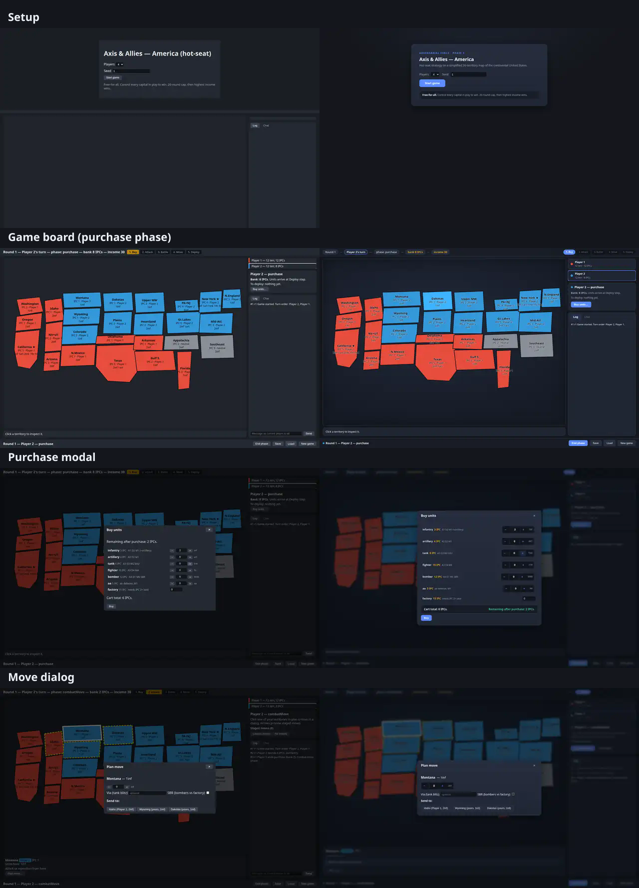

# AI Axis & Allies — America

Hot-seat Axis & Allies–style strategy game on a simplified **26-territory map of
the continental United States**. 2–4 player free-for-all, no backend — game
state lives in the browser with JSON export/import.

This is **Phase 1** of a larger project: in Phase 2, LLM agents will replace some
or all human players and negotiate with each other via chat. The engine and UI
are built so Phase 2 is an additive layer, not a rewrite — the action API the
UI drives is the same tool set agents will use.



## Quickstart

Prerequisites: [Node.js](https://nodejs.org/) 18+ (20 LTS recommended), npm 9+,
a modern browser.

```bash
git clone https://github.com/hayneian000/axis-allies-ai.git
cd axis-allies-ai
npm install
npm run dev      # open the printed URL (usually http://localhost:5173)
```

Production build:

```bash
npm run build     # type-checks (tsc --noEmit), then builds to dist/
npm run preview   # serves dist/ at http://localhost:4173
```

## Playing the game

Each turn runs the same six phases — the stepper at the top tracks where you are:

**Buy → Attack → Battle → Move → Deploy → (income)**

1. **Buy** — spend IPCs from your bank on units (they arrive at Deploy).
2. **Attack** — click one of your territories, dial units in the dialog, pick a
   destination. Staged moves preview as arrows (red = attack, green = move).
3. **Battle** — open each battle, roll rounds, assign casualties (or Auto),
   retreat or fight on.
4. **Move** — reposition within your own ground; aircraft must end on ground
   held since turn start or they're lost.
5. **Deploy** — click a factory territory, dial units from your purchase pool,
   stage, then deploy all.
6. **Income** — collect IPCs for territories you hold; capturing a capital
   transfers the victim's bank to you.

**Winning:** hold every capital in play. 20-round cap — then highest income
wins (tie: bank). Lose your capital and you get no purchases and no income
until you take it back.

Click any territory to inspect it: owner, IPC value, units, factory status.

## Project structure

| Path        | What it is |
|-------------|------------|
| `engine/`   | Pure headless rules engine (`engine.ts`, `types.ts`). No DOM, no I/O. Every state change goes through one validated action function; failures return `{ ok: false, code, error }` and never mutate state. |
| `data/`     | All tunable content as JSON: `map.json` (territories, IPC, adjacency, SVG layout), `units.json` (cost/attack/defense/move), `scenario-2p/3p/4p.json` (starting setups), plus the `data.ts` loader. Balance changes are JSON edits. |
| `ui/`       | Plain DOM + SVG front end (`index.html`, `main.ts`, `style.css`) driving the engine through the action API. |
| `tests/`    | Per-phase unit tests, headless simulation bot, jsdom UI playthrough. |
| `scripts/`  | Dev tooling — currently the real-browser screenshot harness. |
| `docs/`     | Guides. Screenshots from UI reviews live in `docs/screenshots/`. |

See [`docs/architecture.md`](docs/architecture.md) for the action API and exactly how a
Phase 2 agent drives a turn.

## Documentation

All guides live in [`docs/`](docs/) — see [`docs/README.md`](docs/README.md)
for the index and how to add one.

| Doc | Covers |
|-----|--------|
| [`docs/architecture.md`](docs/architecture.md) | Engine design, game state, the action API (also the Phase 2 tool set) |
| [`docs/testing.md`](docs/testing.md) | Test suite guide: per-phase suites, the sim bot, conventions |
| [`docs/browser-testing.md`](docs/browser-testing.md) | Real-browser screenshot harness: setup, the deterministic playthrough, the `single.html` trick, adding scenarios |
| [`docs/ui-guide.md`](docs/ui-guide.md) | UI conventions: design tokens, DOM contract, theming, review workflow |
| [`docs/phase2-agents.md`](docs/phase2-agents.md) | Phase 2 sketch: how LLM agents will drive turns (roadmap, not spec) |
| [`docs/history/`](docs/history/) | Superseded specs — currently the original Phase 1 build prompt |

## Testing

### Unit / integration — `npm test`

```bash
npm test                          # full suite (engine, data, simulation, UI)
npx vitest run tests/combat.test.ts     # one file at a time, e.g.:
npx vitest run tests/ui.test.ts        # jsdom UI playthrough
npm run simulate                  # headless bot games played to an ending
```

| Test file | Covers |
|-----------|--------|
| `purchase` / `movement` / `combat` / `economy` / `edge` | One phase group each, incl. boundary and invalid inputs |
| `map` | Map + scenario data validation (coverage, contiguous holdings, factory on every capital) |
| `simulation` | Headless random-policy bot plays seeded 2/3/4-player games to `gameover`, asserting invariants every turn |
| `ui` | jsdom playthrough: start game, buy, declare an attack through the SVG map, fight it in the combat panel, finish the turn, chat |

### Browser testing — `npm run screenshots`

Drives the real UI in headless Chromium through a deterministic scripted
playthrough (2 players, seed 7) and captures PNGs of all 8 major screens:
setup, board, purchase modal, move dialog, staged moves, battle dialog, chat,
mobilize. Full setup documented in
[`docs/browser-testing.md`](docs/browser-testing.md).

```bash
npm run screenshots            # needs a Chromium; set CHROME_PATH if not found
```

## Rules notes

- Turn: purchase → combat move → combat → non-combat → mobilize → collect income.
- Capturing a capital transfers the victim's bank. No capital = no purchases, no income.
- Aircraft must end non-combat on ground held since turn start or they are lost.
- New or captured factories produce from next turn.
- The IPC table in the spec sums to **61**, not 64 — values kept as specified.
- Four Corners point-contacts (CO–AZ, NM–UT) are not adjacency.

## Roadmap

- **Phase 2:** LLM agents drive turns through the action API
  (`summarizeState` for prompts, `sendMessage`/`chatLog` for negotiation,
  `autoCasualties` to skip casualty choice). See [`docs/architecture.md`](docs/architecture.md)
  ("How a Phase 2 agent drives one turn").
- **Later:** tournament harness, Elo-style ratings, cost/latency tracking.

## Troubleshooting

- **Port 5173 already in use** — Vite will offer the next free port; use the URL
  it prints, or free the port first.
- **`npm install` fails** — delete `node_modules/` and `package-lock.json`, then
  `npm install` again. Make sure Node is v18+.
- **`npm run build` type errors** — run `npx tsc --noEmit` to see them; the
  build will not emit `dist/` until they pass.
- **Blank page in dev** — check the terminal running `npm run dev` and the
  browser devtools console for errors, then file an issue with both.
